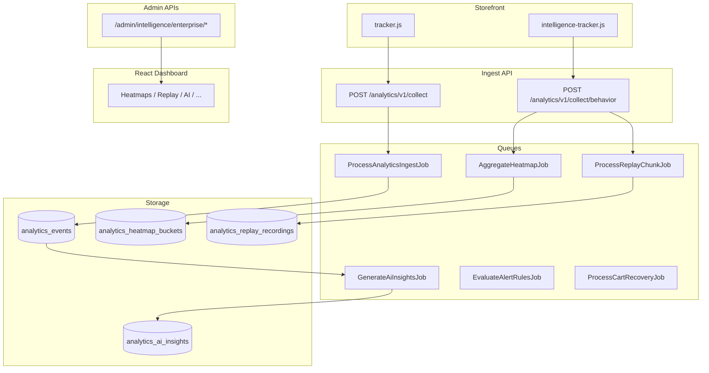

# Shopperzz Enterprise Intelligence — Architecture & Implementation Plan

## Executive summary

Extends the existing **Laravel analytics module** + **React 19 dashboard** + **tracker.js** without breaking `/api/admin/intelligence/*` or `/api/analytics/v1/collect`.

| Layer | Responsibility |
|--------|----------------|
| **Ingest** | `collect` (existing) + `collect/behavior` (heatmap, replay chunks) |
| **Process** | Queued jobs → aggregates, insights, alerts, recovery |
| **Store** | MySQL (partition-ready), Redis hot counters, optional S3 for replay blobs |
| **Serve** | New `/api/admin/intelligence/enterprise/*` APIs |
| **UI** | New dashboard routes under Analytics app |

---

## Architecture diagram



---

## Multi-tenant model

Every row includes `site_id` (FK `analytics_sites`). Workspace-level billing uses `workspace_id` on sites.

Feature gates: `config('analytics_enterprise.features.{feature}')` + plan middleware (Phase 10).

---

## Database schema (new tables)

### 1. Heatmaps

| Table | Purpose |
|-------|---------|
| `analytics_heatmap_buckets` | Aggregated clicks/scroll depth per `page_path`, viewport bucket, device |
| `analytics_behavior_events` | Short-TTL raw batches (optional roll-up, 7-day retention job) |

Indexes: `(site_id, page_path, bucket_date, device_type)`, `(site_id, occurred_at)`.

### 2. Session replay

| Table | Purpose |
|-------|---------|
| `analytics_replay_recordings` | Session meta: duration, pages, device, visitor |
| `analytics_replay_chunks` | Gzip JSON chunks `sequence`, `storage_path` or `payload` MEDIUMBLOB |

Privacy: mask `[data-analytics-mask]`, never store password/cvv values.

### 3. AI insights

| Table | Purpose |
|-------|---------|
| `analytics_ai_insights` | `type`, `severity`, `title`, `summary`, `recommendation`, `metrics` JSON, `status` |

Generated by cron + optional LLM adapter interface.

### 4. Abandoned cart recovery

| Table | Purpose |
|-------|---------|
| `analytics_recovery_campaigns` | Channel, template, delay, discount |
| `analytics_recovery_queue` | Scheduled sends, cart snapshot JSON |
| `analytics_recovery_events` | sent/opened/clicked/recovered |

Links to existing `checkout_abandoned` events + live cart API.

### 5. Customer journey

| Table | Purpose |
|-------|---------|
| `analytics_journey_entries` | Materialized timeline per visitor/user |
| Uses `analytics_events` as source of truth |

Merge: `visitor_uuid` + `user_id` on identify.

### 6. LTV & segmentation

| Table | Purpose |
|-------|---------|
| `analytics_customer_scores` | LTV, churn_score, RFM, segment_slug |
| `analytics_segment_definitions` | Rule JSON per site |

Reuses commerce orders + visitor LTV column.

### 7. A/B testing

| Table | Purpose |
|-------|---------|
| `analytics_experiments` | variants, traffic %, status |
| `analytics_experiment_assignments` | visitor → variant |
| `analytics_experiment_results` | daily aggregates |

### 8. Attribution & ROAS

| Table | Purpose |
|-------|---------|
| `analytics_attribution_touches` | Per order/session touch list |
| `analytics_campaign_costs` | ad spend by source/campaign/date |

Models: first-click, last-click, linear (multi-touch).

### 9. Smart alerts

| Table | Purpose |
|-------|---------|
| `analytics_alert_rules` | metric, operator, threshold, channels |
| `analytics_alert_incidents` | fired alerts, acknowledged |

### 10. SaaS billing

| Table | Purpose |
|-------|---------|
| `analytics_saas_plans` | limits JSON, price |
| `analytics_saas_subscriptions` | workspace, plan, stripe_id |
| `analytics_saas_usage` | events/month meter |

---

## API routes (additive)

Prefix: `GET|POST /api/admin/intelligence/enterprise` (Sanctum + site_id).

| Group | Endpoints |
|-------|-----------|
| **heatmaps** | `GET pages`, `GET {pagePath}`, `GET snapshot` |
| **replay** | `GET sessions`, `GET sessions/{id}`, `GET sessions/{id}/stream` (signed URL) |
| **insights** | `GET insights`, `PATCH insights/{id}/dismiss` |
| **recovery** | `CRUD campaigns`, `GET stats`, `POST test-send` |
| **journey** | `GET visitors/{uuid}`, `GET customers/{userId}` |
| **segments** | `GET segments`, `GET segments/{slug}/members`, `POST recalculate` |
| **experiments** | CRUD + `GET {id}/results` |
| **attribution** | `GET report`, `GET campaigns`, `POST costs` |
| **alerts** | CRUD rules + `GET incidents` |
| **billing** | `GET plans`, `GET subscription`, `POST portal` (Stripe) |

Ingest: `POST /api/analytics/v1/collect/behavior` (same site key middleware).

---

## Frontend routes (Analytics app)

| Path | Page |
|------|------|
| `/heatmaps` | Heatmap viewer |
| `/session-replay` | Session list + player |
| `/ai-insights` | Insight cards |
| `/marketing/recovery` | Cart recovery |
| `/customers/journey` | Timeline |
| `/customers/segments` | Segments + LTV |
| `/optimization/experiments` | A/B tests |
| `/marketing/attribution` | Attribution + ROAS |
| `/settings/alerts` | Alert builder |
| `/admin/billing` | SaaS billing |

---

## Implementation order (recommended)

| Phase | Weeks | Deliverables |
|-------|-------|--------------|
| **0** | 1 | Migration, config, enterprise routes, tracker extension stub, dashboard nav |
| **1** | 2 | Heatmaps ingest + aggregation + viewer |
| **2** | 2 | Session replay capture + player |
| **3** | 1 | AI insights rule engine + cron |
| **4** | 2 | Customer journey API + UI |
| **5** | 2 | Segments + LTV (extend existing RFM API) |
| **6** | 2 | Cart recovery queues + templates |
| **7** | 2 | A/B experiments + storefront assignment |
| **8** | 2 | Attribution + ROAS |
| **9** | 1 | Smart alerts |
| **10** | 3 | SaaS billing + feature gates |

---

## Optimization strategy

- **Ingest**: batch 20–50 events; behavior endpoint max 512KB, separate rate limit.
- **Heatmaps**: aggregate to 32×32 grid server-side; never render millions of points in browser.
- **Replay**: chunk 30s, gzip, store on disk/S3; stream via signed URLs.
- **Events table**: monthly partitions (future), composite indexes `(site_id, event_name, occurred_at)`.
- **Redis**: realtime counters, dedup, insight generation locks.
- **Queues**: dedicated `analytics` queue; horizon workers ≥ 2.

---

## Security & GDPR

- IP hashed; replay masks inputs; EU delete visitor cascades.
- Signed replay URLs (TTL 15 min).
- Tenant isolation: global scopes on `site_id`.
- Rate limits per site key.

---

## Deployment

```bash
php artisan migrate
php artisan queue:work --queue=analytics,default
php artisan schedule:run  # insights + alerts + recovery
```

Deploy `public/analytics/intelligence-tracker.js` + bump `serviceworker.js` if needed.

React: `npm run build` → commit `dist/` (per your Git workflow).

---

## Code layout

```
shopperzz/app/Analytics/Enterprise/
  Http/Controllers/Admin/IntelligenceEnterpriseController.php
  Http/Requests/BehaviorIngestRequest.php
  Services/HeatmapService.php
  Services/ReplayService.php
  Services/InsightsEngineService.php
  Services/JourneyService.php
  Services/SegmentService.php
  Jobs/AggregateHeatmapJob.php
  Jobs/GenerateAiInsightsJob.php
  Models/...

shopperzz/public/analytics/intelligence-tracker.js

analytics/src/api/enterprise.js
analytics/src/pages/enterprise/*
```

Existing APIs remain unchanged.
